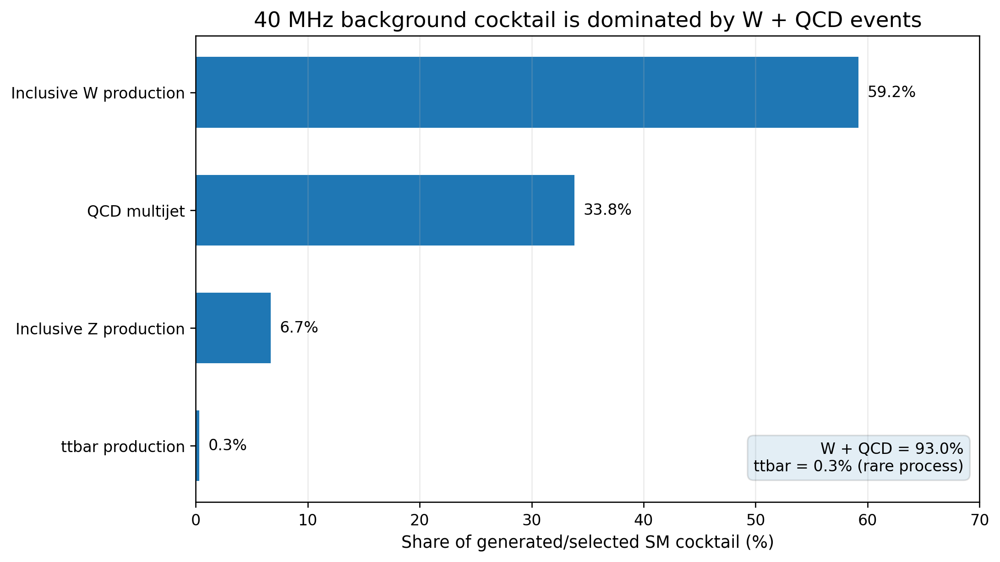
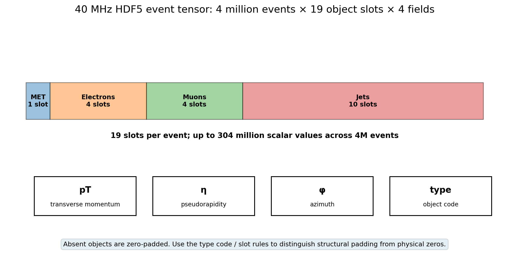

# CA3 Big Data Case Study Analysis

## 1. Title of Case Study

**Big Data Analytics for LHC Event Quality and Exploratory Outlier Ranking in 40 MHz Training Data**

## 2. Problem Statement and Objectives

**Problem.** Analyse 4,000,000 simulated proton-proton collision events in one 646.4 MB HDF5 record. Preserve every event. Validate tensor quality. Derive interpretable event features. Query the full corpus with Spark SQL and key-value aggregation. Produce evidence-led graphics and optional cluster-distance diagnostics.

**Objectives.**
1. Verify source identity, size, checksum, HDF5 keys and tensor dimensions.
2. Quantify invalid values, particle-type violations, negative transverse momentum, padding inconsistencies and object multiplicities.
3. Convert all events into typed Parquet records with explicit feature definitions.
4. Measure object occupancy, transverse-momentum spectra, jet activity, missing transverse momentum and feature correlations.
5. Demonstrate SQL aggregation, partitioned storage, `map` / `reduceByKey`, HiveQL-compatible queries and an optional Pig Latin dataflow.
6. Evaluate optional unsupervised feature-space clustering; record score meaning and scientific limits.

## 3. Background / Introduction

CERN's Large Hadron Collider produces proton-proton collision events. ATLAS and CMS use trigger stages to select events under throughput and latency constraints. The 40 MHz dataset paper presents simulated event records for research on unsupervised event selection in a Level-1 trigger context [1].

This CA3 implementation runs offline batch analytics. Source events simulate 13 TeV proton-proton collisions. Selection requires an electron or muon with transverse momentum above 23 GeV, with pseudorapidity cuts described in [1]. PYTHIA / DELPHES-derived detector-level objects supply the engineered event records. The finite training corpus represents a selected trigger-input stream; 40 MHz names the intended use case.

## 4. Dataset Description

| Property | Published specification |
|---|---|
| Repository | [Zenodo training record](https://zenodo.org/records/5046428) |
| File | `background_for_training.h5` |
| Download size | 646.4 MB on record page |
| Event count | 4,000,000 |
| Format | HDF5 |
| Primary tensor | `Particles`, shape `(N, 19, 4)` |
| Metadata keys | `Particles_Names`, `Particles_Classes` |
| Expected MD5 | `08cb4801229f9d480567f8d3f5cac134` |
| Particle slots | MET, four electrons, four muons, ten jets |
| Fields | `pT`, `eta`, `phi`, particle-type code |

Type code: `0` structural padding, `1` MET, `2` electron, `3` muon, `4` jet. Published angular convention: `phi ∈ [-π, π]`; momentum uses GeV under natural units [1]. Each event has 19 slots and four scalar values per slot. Padding preserves fixed tensor shape when objects are absent.

Published SM mixture proportions, accounting for process cross-section and event selection: inclusive W production 59.2%, QCD multijet 33.8%, inclusive Z production 6.7%, top-pair production 0.3% [1]. These are paper-reported proportions. The selected training record does not expose a per-event process label for independent reconstruction of these shares. Four separate signal records and a separate black-box record exist in the wider challenge release; this project uses the complete main training file alone to preserve the 200 MB to 1 GB constraint without row filtering or dataset stitching.

## 5. Methodology

**Stage A: provenance and integrity.** Query Zenodo record metadata. Match exact filename and checksum. Stream download to a temporary file. Accept final path only after MD5 and byte count pass. Record SHA-256 for local identity.

**Stage B: full raw audit.** Traverse `Particles` in 25,000-row chunks. Enumerate every HDF5 key, dimension, dtype, compression setting and attribute. Count every scalar's finite/NaN/infinity status. Validate type-code domain, expected slot placement, nonnegative occupied-slot `pT`, angular range and zero-padding consistency. Accumulate exact pT histograms and electron/muon/jet multiplicity distributions.

**Stage C: event feature engineering.** Convert every tensor row into one Parquet row. Preserve source ordinal as `event_row_id`. Create object counts, leading-object `pT`, jet scalar activity, lepton scalar activity, MET fields and row-level quality flags. Output count must equal raw HDF5 event count. Raw source remains immutable.

**Stage D: batch analytics.** Spark reads all feature rows, persists a copy partitioned by `n_jets`, verifies count parity, executes seven SQL query groups and performs RDD key-value aggregation. Matplotlib consumes exact full-file counters and the complete feature table.

**Stage E: optional clustering.** Fit `StandardScaler` over every feature row. Update `MiniBatchKMeans` across every event batch. Score every row with standardized Euclidean distance to its nearest centroid. Save model parameters and all scores. Distance is an exploratory statistic, not a signal probability.

## 6. System Architecture / Workflow

```text
Zenodo API + published checksum
          ↓
Complete HDF5 download and verification
          ↓
Full-file chunked schema / quality audit
          ↓
All-event feature engineering → typed Parquet
          ↓
Spark SQL + partitioned Parquet + RDD map/reduce
          ↓
Metric tables + full-corpus Matplotlib plots
          ↓
Optional full-corpus cluster-distance analysis
          ↓
CA3 report tables, conclusions and viva evidence
```

Pipeline control uses Docker Compose. Host directories persist raw input, audits, Parquet, query outputs and images. Default compute: single-node Spark `local[6]`, 6 GB driver heap, 12 shuffle partitions, 25,000-row HDF5 / Parquet batches. Container memory cap: 10 GB. These are starting settings; actual runtime and peak memory must come from execution manifests.

## 7. Big Data Tools and Technologies

| Technology | Project role |
|---|---|
| Docker Engine / Compose | Reproducible Linux execution environment |
| Python 3.11 | Pipeline orchestration and numerical transforms |
| `h5py`, NumPy | Complete HDF5 traversal, tensor checks and feature extraction |
| PyArrow / Parquet | Bounded-memory conversion, columnar intermediate storage |
| Apache Spark 3.5.7 / PySpark | Full-table query execution, repartitioning, distributed-style aggregation API |
| Spark SQL | Seven query groups: overview, multiplicities, jet activity, MET-HT bins, integrity flags, extreme activity, correlations |
| RDD `map` / `reduceByKey` | Core key-value aggregation by jet multiplicity over every event |
| Hadoop Streaming (optional existing cluster) | `hadoop/mapper.py` + `hadoop/reducer.py`; genuine HDFS MapReduce job over a full-row TSV projection |
| HiveQL | Query files use Hive-compatible SQL constructs; `hive/register_events.hql` registers a native external table for an existing Hive installation |
| Apache Pig 0.17 (optional) | Pig Latin grouped aggregation in local mode on a TSV projection of all event rows |
| Matplotlib | Physics and quality graphics |
| scikit-learn (optional) | Streaming scaling and mini-batch clustering |

The default Docker path runs SQL through Spark SQL. Native HiveServer2 is an optional external execution target. The Pig profile demonstrates Pig Latin local-mode semantics; neither option claims a multi-node Hadoop cluster. `make all` remains reproducible without these optional services.

### CA3 course-outcome evidence

| Outcome | Evidence produced |
|---|---|
| CO4, Hive / Pig query analysis | Seven Spark SQL query groups; Hive external-table DDL; Pig `GROUP` / `FOREACH` / `AVG`; result directories and row counts. |
| CO4, MapReduce concepts | Full-corpus key-value aggregation in Spark RDD plus separately runnable Hadoop Streaming mapper/reducer. |
| CO5, intelligent analysis | Optional MiniBatchKMeans scaler-fit, full-corpus cluster updates and per-event distance output. This implementation uses scikit-learn; it does **not** claim an Apache Mahout job. If faculty requires Mahout specifically for CO5, that literal tool requirement remains an additional integration item. |
| Course Unit 4, Spark ML concepts | Feature scaling and unsupervised cluster analysis are demonstrated through batch-processing APIs; interpretation remains descriptive. |

## 8. Implementation / Queries / Algorithms

### Integrity algorithm

For each HDF5 chunk: inspect `x[:, :, :]`; accumulate exact counts for NaN, positive infinity, negative infinity, type codes outside `{0,1,2,3,4}`, negative `pT` in occupied slots, nonzero kinematics under type-zero padding, and type codes in unexpected fixed slots. Merge per-chunk counters. Process every event row.

### Feature definitions

For particle slot `i`, transverse momentum is `pT_i`; type code is `t_i`.

\[
N_{e}=\sum_i \mathbf{1}(t_i=2),\quad
N_{\mu}=\sum_i \mathbf{1}(t_i=3),\quad
N_{j}=\sum_i \mathbf{1}(t_i=4)
\]

\[
H_T^{jets}=\sum_i pT_i\mathbf{1}(t_i=4),\qquad
S_T^{leptons}=\sum_i pT_i\mathbf{1}(t_i\in\{2,3\})
\]

Leading-object fields use the maximum `pT` over slots matching each type. Empty collections map to zero and remain distinguishable through object-count fields. Every engineered row contains quality indicators.

### SQL analyses

1. **Corpus overview:** count events, quality flags, mean / approximate median / 95th percentile of MET and jet `H_T`.
2. **Multiplicity:** count events by electron, muon and jet multiplicity.
3. **Jet activity:** event count, mean and quartiles of jet `H_T` by jet count; correlation with MET.
4. **MET-HT density:** 20 GeV MET bins × 50 GeV jet-HT bins.
5. **Integrity groups:** counts by per-event quality flags.
6. **High-activity review list:** 100 highest-HT events for inspection only.
7. **Feature correlation:** Pearson coefficients among MET, jet HT, lepton scalar pT, object counts and maximum absolute eta.

### MapReduce-style aggregation

Mapper: `event → (n_jets, (1, H_T^jets, MET, S_T^leptons))`. Reducer: elementwise sum for each `n_jets` key. Finalizer: divide feature totals by event count. Spark RDD stage asserts total reduced count equals full source row count. `hadoop/mapper.py` and `hadoop/reducer.py` provide the same algorithm for a separately configured HDFS cluster.

### Optional clustering

Input: numeric kinematic and multiplicity columns defined in the data dictionary; exclude row ordinal and quality flags from model features. Scaling fit, cluster updates and scoring each traverse all rows by batch. Output: `event_row_id`, `n_jets`, `cluster_id`, `centroid_distance`. Cluster distance depends on feature engineering and scaling. Rare SM topologies and detector/reconstruction effects may receive high distances; interpretation needs physics review.

## 9. Analysis and Results

**Source-verified observations:** four million training events; 19 fixed object slots; four values per slot; electron/muon preselection; structural zero padding; paper-reported SM mixture proportions shown in Figure 1. These specifications motivate complete schema verification, occupancy profiling and conditional kinematic analysis.

**Empirical result contract:** exact NaN / infinity counts, invalid type counts, negative-pT counts, padding violations, distribution statistics, correlations, runtime and output sizes are emitted by the full-file commands. `audit/raw_audit.json`, `data/processed/etl_manifest.json`, `outputs/spark/spark_manifest.json` and `outputs/figures/visual_manifest.json` provide the evidence. These numeric findings depend on the verified local file; they cannot be inferred from tensor dimensions or published process fractions. The analysis pipeline records source and output event counts before interpretation.

Interpretation rules: expected padding receives a separate structural count. Invalid encodings require investigation. A high-HT event is a review candidate. A large centroid distance indicates feature-space atypicality under this model. Scientific discovery claims require validated selection, uncertainty treatment and suitable truth or control data. This main file supplies no per-event new-physics ground truth for computing supervised signal-detection metrics.

## 10. Visualization / Graphs

### Figure 1. Published Standard Model process mixture



Reading: W production and QCD multijet account for 93.0% combined. Top-pair production contributes 0.3% in the paper's selected mixture. Plot encodes published cross-section / selection-weighted proportions; counts are not reconstructed from hidden event labels.

### Figure 2. Documented tensor layout



Reading: every event provides 19 slots. Type metadata separates real objects from zero padding. Correct handling is required for multiplicity and pT summaries.

### Data-derived figures

`make all` creates seven graphics from all raw rows / all engineered event rows:

- `01_pt_spectrum_by_object_type.png`: full-file pT counts for MET, electrons, muons and jets.
- `02_event_multiplicity.png`: electron, muon and jet count distributions.
- `03_met_vs_jet_ht_density.png`: joint density for MET and scalar jet HT.
- `04_ht_by_jet_multiplicity.png`: exact HT quartiles and means by jet count.
- `05_data_quality_flags.png`: nonfinite, invalid-type, negative-pT and padding-consistency flags; expected padding shown separately.
- `06_feature_correlations.png`: full-corpus Pearson matrix over engineered event variables.
- `07_full_corpus_ht_distribution.png`: complete jet-activity distribution on a signed-log axis, retaining upper-tail visibility and negative values.

`make ml` followed by `make plots` adds cluster-distance distribution and distance-by-multiplicity figures. Every plot records its data basis in `visual_manifest.json`.

## 11. Conclusion

The 40 MHz training file fits the required storage interval as one complete record. Its fixed-width, high-dimensional particle representation supports substantive data-quality checks, event feature engineering, columnar storage, SQL aggregation, key-value reduction and scientifically meaningful graphics on a six-core CPU. Docker constrains dependencies and execution; Parquet makes event-level queries repeatable. Optional cluster distances add an unsupervised analytical layer while preserving full-corpus processing.

The core pipeline supplies reproducible ETL, SQL, MapReduce aggregation, visual analysis and integrity checks. Final empirical claims require checksum-verified execution and generated manifests. The project makes no claim of reproducing real-time 40 MHz trigger latency on a laptop. Literal Mahout usage remains outside the implementation; the ML experiment documents its scikit-learn engine explicitly.

## 12. References

1. E. Govorkova et al., “LHC physics dataset for unsupervised New Physics detection at 40 MHz,” *Scientific Data*, 9, 118 (2022). [Article and data description](https://www.nature.com/articles/s41597-022-01187-8), [DOI](https://doi.org/10.1038/s41597-022-01187-8).
2. CERN / Fermilab authors, “Unsupervised New Physics detection at 40 MHz: Training Dataset.” [Zenodo record 5046428](https://zenodo.org/records/5046428). File checksum and size verified by the downloader at execution.
3. Machine Learning for Particle Physics, “Anomaly Detection Challenge 2021.” [Official challenge page](https://mpp-hep.github.io/ADC2021/).
4. Apache Software Foundation, “Spark SQL, DataFrames and Datasets Guide,” Spark 3.5.7. [Documentation](https://spark.apache.org/docs/3.5.7/sql-programming-guide.html).
5. Apache Software Foundation, “Hive Language Manual: UDF.” [Documentation](https://hive.apache.org/docs/latest/language/languagemanual-udf/).
6. Apache Software Foundation, “Apache Pig.” [Project documentation](https://pig.apache.org/).
7. Zenodo developers, “REST API.” [Documentation](https://developers.zenodo.org/).
